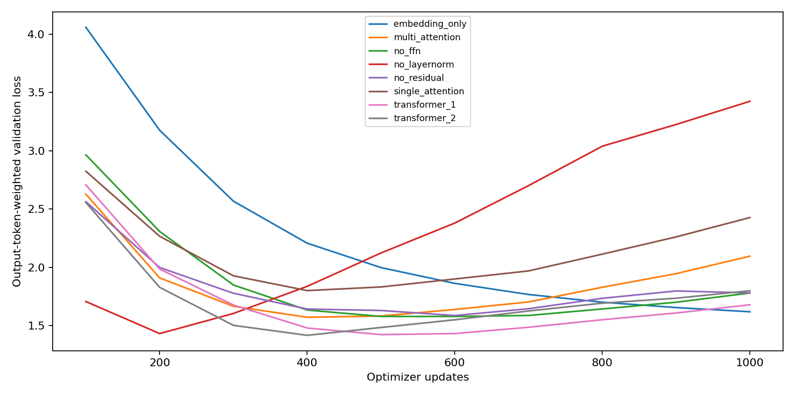

# Tiny Mitra: final submission evidence

One frozen corpus of 1,000 synthetic notes: 700 training, 100 validation and four final partitions of 50. Every architecture starts from random weights and uses its registered final 4,000th update. Earlier models do not initialize these weights. Vocabulary146, width64, FFN192, context256; head count/components follow the registry. The minimum-loss checkpoint is kept separately and does not replace the final-update comparison.

8 of 8 model runs have saved development generations. Passing engineering checks is separate from the authored/clinical quality gates and held-out generalization.

| Architecture | Update | Parameters | Diagnostic exact notes | Correct typed replacements | Preserved clinical associations | Authored exact notes |
| --- | ---: | ---: | ---: | ---: | ---: | ---: |
| transformer_2 | 4000 | 118802 | 23/24 | 36/36 | 23/24 | 10/11 |
| embedding_only | 4000 | 35218 | 2/24 | 9/36 | 1/24 | 0/11 |
| single_attention | 4000 | 51858 | 22/24 | 33/36 | 23/24 | 10/11 |
| multi_attention | 4000 | 51858 | 20/24 | 34/36 | 21/24 | 8/11 |
| transformer_1 | 4000 | 77074 | 23/24 | 35/36 | 24/24 | 11/11 |
| no_ffn | 4000 | 68882 | 23/24 | 35/36 | 24/24 | 11/11 |
| no_layernorm | 4000 | 118162 | 23/24 | 36/36 | 23/24 | 9/11 |
| no_residual | 4000 | 118802 | 24/24 | 36/36 | 24/24 | 11/11 |

The 24 diagnostic notes are category-selected validation examples. Entity/layout pool coverage: known/known=24. Teacher-forced validation uses all 100 notes; complete final partitions are reported separately.

Authored demo gate: not passed. See audit.json for actual outputs/counts and scope.

Additional clinical preservation checks: passed. See clinical_acceptance.json for actual outputs/counts and scope.

### Training-seed sensitivity

8/8 additional runs complete: four architectures at seeds7/123. Seeds vary both initial weights and minibatch order. These use the same24 validation diagnostics and11 authored notes; descriptive differences do not establish statistical significance. Component ablations beyond these four retain one seed.

| Architecture | Seed | Diagnostic exact notes | Correct identifiers | Preserved clinical associations | Authored exact notes |
| --- | ---: | ---: | ---: | ---: | ---: |
| transformer_2 | 7 | 24/24 | 36/36 | 24/24 | 11/11 |
| transformer_2 | 123 | 24/24 | 36/36 | 24/24 | 11/11 |
| embedding_only | 7 | 1/24 | 5/36 | 0/24 | 0/11 |
| embedding_only | 123 | 2/24 | 9/36 | 1/24 | 0/11 |
| single_attention | 7 | 22/24 | 35/36 | 23/24 | 11/11 |
| single_attention | 123 | 18/24 | 35/36 | 19/24 | 9/11 |
| multi_attention | 7 | 24/24 | 36/36 | 24/24 | 9/11 |
| multi_attention | 123 | 22/24 | 34/36 | 22/24 | 9/11 |

Development-only demo selection: final_seed7/transformer_2. The primary seed42 architecture comparison remains unchanged. See DEMO_SELECTION_PROTOCOL.json for timing disclosure, priority and gate; final-test outcomes do not choose this candidate.

Complete final partitions: 32/32 rows saved. Release requires the separate final protocol review. Fifty notes per row; 200 distinct test notes reused across eight models. Development names are excluded from the final name pool. Controls share layouts and dates/doctor/address policies retain their declared limitations.

| Architecture | Partition | Exact notes | Correct identifiers | Clinical associations |
| --- | --- | ---: | ---: | ---: |
| embedding_only | test_known_known | 2/50 | 11/89 | 2/44 |
| embedding_only | test_known_test | 0/50 | 3/128 | 1/67 |
| embedding_only | test_test_known | 2/50 | 12/86 | 3/33 |
| embedding_only | test_test_test | 0/50 | 16/142 | 0/53 |
| single_attention | test_known_known | 39/50 | 78/89 | 34/44 |
| single_attention | test_known_test | 5/50 | 0/128 | 22/67 |
| single_attention | test_test_known | 38/50 | 67/86 | 29/33 |
| single_attention | test_test_test | 5/50 | 0/142 | 15/53 |
| multi_attention | test_known_known | 35/50 | 82/89 | 32/44 |
| multi_attention | test_known_test | 5/50 | 1/128 | 20/67 |
| multi_attention | test_test_known | 44/50 | 82/86 | 29/33 |
| multi_attention | test_test_test | 5/50 | 0/142 | 16/53 |
| transformer_1 | test_known_known | 48/50 | 89/89 | 42/44 |
| transformer_1 | test_known_test | 5/50 | 10/128 | 25/67 |
| transformer_1 | test_test_known | 50/50 | 86/86 | 33/33 |
| transformer_1 | test_test_test | 5/50 | 0/142 | 20/53 |
| transformer_2 | test_known_known | 47/50 | 88/89 | 42/44 |
| transformer_2 | test_known_test | 5/50 | 0/128 | 31/67 |
| transformer_2 | test_test_known | 50/50 | 86/86 | 33/33 |
| transformer_2 | test_test_test | 5/50 | 1/142 | 30/53 |
| no_ffn | test_known_known | 48/50 | 89/89 | 42/44 |
| no_ffn | test_known_test | 5/50 | 1/128 | 28/67 |
| no_ffn | test_test_known | 50/50 | 86/86 | 33/33 |
| no_ffn | test_test_test | 5/50 | 1/142 | 28/53 |
| no_layernorm | test_known_known | 46/50 | 87/89 | 42/44 |
| no_layernorm | test_known_test | 5/50 | 1/128 | 27/67 |
| no_layernorm | test_test_known | 47/50 | 77/86 | 33/33 |
| no_layernorm | test_test_test | 5/50 | 0/142 | 21/53 |
| no_residual | test_known_known | 50/50 | 89/89 | 44/44 |
| no_residual | test_known_test | 5/50 | 5/128 | 33/67 |
| no_residual | test_test_known | 50/50 | 86/86 | 33/33 |
| no_residual | test_test_test | 5/50 | 6/142 | 28/53 |

### Already development-selected demo: separate final-test evidence

Model: final_seed7/transformer_2. Status: complete. Its selection was fixed from development evidence before these outcomes. Same200 test notes as the primary comparison; no claim of additional independent cases.

| Partition | Exact notes | Correct identifiers | Clinical associations |
| --- | ---: | ---: | ---: |
| test_known_known | 49/50 | 88/89 | 44/44 |
| test_known_test | 5/50 | 1/128 | 26/67 |
| test_test_known | 43/50 | 68/86 | 33/33 |
| test_test_test | 5/50 | 0/142 | 21/53 |

## Final-corpus interpretation

Read [FINAL_FINDINGS.md](FINAL_FINDINGS.md) for all nine reviewed questions, observations, verdicts and limits. These are author self-reviews, not independent sign-off or statistical proof. The final study is a descriptive follow-up after earlier development studies. The five exact notes on each new-layout partition for the full models are the five no-identifier controls; this is not successful redaction of novel layouts.

[Recomputed test loss and next-token accuracy](../artifacts/mitra_final/results/final_test/token_metrics_audit.json) covers all32 primary model/partition rows. Teacher forcing supplies the correct output prefix and scores output/EOS tokens, so it differs from free-generation exact match. Histories retain last-minibatch training loss and full100-note validation metrics.

## Earlier studies — separate histories

The following results preserve earlier datasets, tokenizers, budgets and selection rules. They do not establish robustness of the final model and must not be relabelled as its metrics.

## Version 1: original flat-field study

Local CPU, 1,000 optimizer updates per architecture, training seed 42. Generated-note metrics below use 12 validation diagnostics; teacher-forced validation uses all 100 validation examples. Minimum-validation-loss checkpoints are selected. The original dataset omits some instructor sentence forms; the separate version-2 study corrects coverage. These are synthetic educational measurements, not production de-identification claims.

| Architecture | Validation loss | Token accuracy | Redaction recall | Exact notes | Clinical preservation |
| --- | ---: | ---: | ---: | ---: | ---: |
| embedding_only | 1.618 | 0.474 | 0.000 | 0.000 | 0.160 |
| single_attention | 1.800 | 0.449 | 0.000 | 0.000 | 0.000 |
| multi_attention | 1.570 | 0.521 | 0.182 | 0.000 | 0.000 |
| transformer_1 | 1.422 | 0.593 | 0.500 | 0.083 | 0.080 |
| transformer_2 | 1.416 | 0.639 | 0.500 | 0.083 | 0.040 |
| no_ffn | 1.578 | 0.588 | 0.364 | 0.167 | 0.080 |
| no_layernorm | 1.431 | 0.573 | 0.409 | 0.083 | 0.040 |
| no_residual | 1.586 | 0.649 | 0.727 | 0.250 | 0.280 |

## Original-study seed repeats

8 of 8 additional runs saved: four architectures, seeds 7 and 123. Seed 42 is the primary study. All use the same 12 validation diagnostics; these repeats vary both weight initialization and minibatch order, not new datasets or independent samples of clinical practice.

| Architecture | Seeds saved | Mean recall [min, max] | Mean exact match [min, max] | Mean clinical preservation [min, max] |
| --- | --- | --- | --- | --- |
| embedding_only | 42, 7, 123 | 0.000 [0.000, 0.000] | 0.000 [0.000, 0.000] | 0.107 [0.000, 0.160] |
| single_attention | 42, 7, 123 | 0.000 [0.000, 0.000] | 0.000 [0.000, 0.000] | 0.000 [0.000, 0.000] |
| multi_attention | 42, 7, 123 | 0.182 [0.091, 0.273] | 0.000 [0.000, 0.000] | 0.000 [0.000, 0.000] |
| transformer_2 | 42, 7, 123 | 0.591 [0.500, 0.727] | 0.111 [0.083, 0.167] | 0.107 [0.040, 0.240] |

Ranges describe observed seed variation. Three seeds and a small shared diagnostic set do not establish statistical significance or universal architecture rankings.

## Original-study frozen final partitions

32 of 32 architecture/partition rows saved. Each completed row evaluates all 50 notes. Seed-42 checkpoints were frozen before release; these outcomes must not tune the reported models. Known/test conditions describe declared entity/layout pools. Controls share layouts and dates may recur.

| Architecture | Partition | Exact notes | Correct identifiers | Preserved clinical fields | Notes with exact-surface leakage |
| --- | --- | ---: | ---: | ---: | ---: |
| embedding_only | test_known_known | 0/50 | 6/113 | 12/93 | 0/50 |
| embedding_only | test_known_test | 0/50 | 9/124 | 15/88 | 0/50 |
| embedding_only | test_test_known | 0/50 | 0/103 | 13/107 | 0/50 |
| embedding_only | test_test_test | 0/50 | 0/136 | 16/82 | 0/50 |
| single_attention | test_known_known | 0/50 | 0/113 | 0/93 | 0/50 |
| single_attention | test_known_test | 0/50 | 0/124 | 0/88 | 0/50 |
| single_attention | test_test_known | 0/50 | 0/103 | 0/107 | 0/50 |
| single_attention | test_test_test | 0/50 | 0/136 | 0/82 | 0/50 |
| multi_attention | test_known_known | 0/50 | 29/113 | 2/93 | 0/50 |
| multi_attention | test_known_test | 0/50 | 0/124 | 0/88 | 0/50 |
| multi_attention | test_test_known | 0/50 | 0/103 | 0/107 | 0/50 |
| multi_attention | test_test_test | 0/50 | 0/136 | 0/82 | 0/50 |
| transformer_1 | test_known_known | 12/50 | 68/113 | 13/93 | 0/50 |
| transformer_1 | test_known_test | 0/50 | 0/124 | 0/88 | 0/50 |
| transformer_1 | test_test_known | 0/50 | 7/103 | 1/107 | 0/50 |
| transformer_1 | test_test_test | 0/50 | 0/136 | 2/82 | 0/50 |
| transformer_2 | test_known_known | 7/50 | 76/113 | 7/93 | 0/50 |
| transformer_2 | test_known_test | 0/50 | 34/124 | 4/88 | 0/50 |
| transformer_2 | test_test_known | 0/50 | 24/103 | 1/107 | 0/50 |
| transformer_2 | test_test_test | 0/50 | 22/136 | 1/82 | 0/50 |
| no_ffn | test_known_known | 3/50 | 57/113 | 5/93 | 0/50 |
| no_ffn | test_known_test | 0/50 | 0/124 | 0/88 | 0/50 |
| no_ffn | test_test_known | 0/50 | 4/103 | 0/107 | 0/50 |
| no_ffn | test_test_test | 0/50 | 0/136 | 0/82 | 0/50 |
| no_layernorm | test_known_known | 4/50 | 58/113 | 6/93 | 0/50 |
| no_layernorm | test_known_test | 0/50 | 8/124 | 6/88 | 0/50 |
| no_layernorm | test_test_known | 0/50 | 2/103 | 4/107 | 0/50 |
| no_layernorm | test_test_test | 0/50 | 0/136 | 7/82 | 0/50 |
| no_residual | test_known_known | 20/50 | 95/113 | 32/93 | 0/50 |
| no_residual | test_known_test | 0/50 | 0/124 | 1/88 | 0/50 |
| no_residual | test_test_known | 1/50 | 19/103 | 4/107 | 0/50 |
| no_residual | test_test_test | 0/50 | 0/136 | 0/82 | 0/50 |

## Version 2: instructor sentence forms

Separate dataset, sentence-anchor evaluator, context256 and registered 2,000-update budget. The original study uses context512 and 1,000 updates. Compare architectures within a series; cross-series differences confound data, context, budget and metrics.

8 of 8 runs have saved development generations. The 24 validation diagnostics and 11 authored instructor/clinical prompts are development evidence, not final-test results.

| Architecture | Selected update | Validation loss | Diagnostic recall | Diagnostic exact | Diagnostic clinical preservation | Authored exact notes |
| --- | ---: | ---: | ---: | ---: | ---: | ---: |
| transformer_2 | 500 | 0.940 | 0.750 | 0.542 | 0.292 | 4/11 |
| embedding_only | 2000 | 1.300 | 0.000 | 0.000 | 0.000 | 0/11 |
| single_attention | 900 | 1.366 | 0.194 | 0.125 | 0.042 | 0/11 |
| multi_attention | 400 | 1.374 | 0.417 | 0.208 | 0.000 | 0/11 |
| transformer_1 | 800 | 0.944 | 0.889 | 0.542 | 0.208 | 4/11 |
| no_ffn | 600 | 1.176 | 0.833 | 0.500 | 0.125 | 3/11 |
| no_layernorm | 200 | 1.175 | 0.556 | 0.417 | 0.125 | 0/11 |
| no_residual | 1400 | 1.120 | 0.972 | 0.792 | 0.625 | 6/11 |

## Fixed task pieces with character fallback

Same assignment-format source strings and split identities, with a declared fixed vocabulary of task pieces plus ASCII character spelling. This series compares the final 2,000-update checkpoint for every architecture. Minimum-loss checkpoints remain available as separate diagnostics. Vocabulary/sequence lengths, parameter counts and older checkpoint-selection rules differ: compare complete-note/clinical outcomes with their scope, not cross-tokenizer loss/perplexity.

8 of 8 runs have saved development generations. The separate demo gate requires the full model to produce all 11 authored prompts exactly with valid EOS; it does not establish held-out generalization.

| Architecture | Fixed update | Parameters | Diagnostic exact | Diagnostic recall | Diagnostic clinical preservation | Authored exact notes |
| --- | ---: | ---: | ---: | ---: | ---: | ---: |
| transformer_2 | 2000 | 118802 | 0.958 | 0.944 | 1.000 | 9/11 |
| embedding_only | 2000 | 35218 | 0.208 | 0.361 | 0.083 | 0/11 |
| single_attention | 2000 | 51858 | 0.542 | 0.917 | 0.375 | 7/11 |
| multi_attention | 2000 | 51858 | 0.875 | 1.000 | 0.875 | 10/11 |
| transformer_1 | 2000 | 77074 | 1.000 | 1.000 | 1.000 | 10/11 |
| no_ffn | 2000 | 68882 | 1.000 | 1.000 | 1.000 | 9/11 |
| no_layernorm | 2000 | 118162 | 1.000 | 1.000 | 1.000 | 9/11 |
| no_residual | 2000 | 118802 | 1.000 | 1.000 | 1.000 | 10/11 |

Authored demo gate: not passed (9/11 exact notes). Engineering checks and model-quality gates are separate.

## Interpretation and raw evidence

Read hypothesis_reviews.json for question, change, observation, verdict, interpretation and limitation. Read per-run raw JSON for exact IDs, expected/generated text, counts, EOS and timings. Original head pairs were selected using validation diagnostics and are exploratory. Attention inspection is conditional on a supplied output prefix. No semantic head role follows automatically from a heatmap or intervention. A lower teacher-forced loss alone does not establish correct free generation.

## Open limits

Small synthetic grammar and diagnostics; single seed for component ablations and version 2; exact-surface leakage can miss partial/reformatted identifiers; shared control templates; actual cloud execution, cross-device verification and learner teach-back pending. No real clinical data was used.
