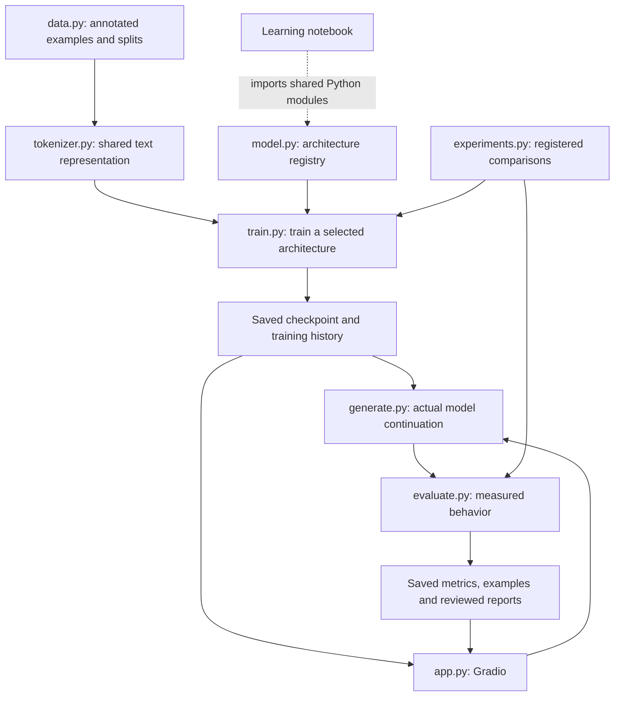

# Tiny Mitra: implementation, learning and demonstration plan

**Plan date:** Sunday, October 18, 2026, Asia/Calcutta.

**Presentation:** Friday, October 23, 2026.

**Speaking slot:** 30–60 minutes.

**Audience:** CTO, CEO, COO, technical architect, Director of Engineering and other leaders.
**Status:** Independent local engineering, final training/evaluation and presentation preparation are complete and reviewed within their stated scopes. Latest browser visual verification, team rehearsal, actual cloud execution and learner mastery remain open. See [TASKS.md](TASKS.md) and [READY_FOR_REVIEW.md](READY_FOR_REVIEW.md) for current evidence; proposal wording below records the original design.

**Execution amendment, October 18:** Nagar authorized all independently actionable engineering work to proceed while unavailable, with personal decisions and learning checks afterward. The proposed character tokenizer is the provisional implementation default. Learner mastery remains unverified. A local CPU preliminary comparison can proceed independently of the later actual-Colab gate. Current executed evidence is recorded in TASKS.md; proposal wording below describes the original design rather than an assertion of completion.

**Representation investigation, October 18:** The original flat-field character study is preserved. A second character study corrects missing instructor sentence forms; its full model achieves only4/11 authored prompts at the minimum-loss checkpoint and5/11 at its last update. A separate fixed-task-piece tokenizer experiment is therefore authorized engineering progress toward a working demonstration. Declared schema/clinical pieces are atomic; all other supported spelling retains character fallback. It reuses our manual architecture, batching, metrics and generation, with an explicit tokenizer-specific training/checkpoint adapter so ongoing character runs are not modified. The same1,000 source strings and split identities are used. New vocabulary/sequence lengths and parameter counts must be disclosed, and per-token loss/perplexity must not be compared across tokenizers as if units were identical. No pretrained model, answer renderer at inference or test-fitted vocabulary is introduced. L01 remains open for explaining this trade-off. See E32 in the ledger for actual results and the demo quality gate.

**Final study and delivery amendment, October 18:** The final comparison uses one separately frozen corpus and task pieces with character fallback, with every architecture trained from random weights for4,000updates. It does not continue an earlier model. All eight primary/eight additional runs and32+4 final rows are complete. Primary42 remains the benchmark; the declared development-only rule selects full seed7 for the demo before final outcomes. New-layout redaction fails severely and remains reported. E28 covers prepared presentation artifacts; L04/E29 cover individual explanation and rehearsal. This separation follows the earlier authorization and does not relax learner mastery.

## 1. Read this first

The intended result is a small GPT that we can **run, compare, investigate and explain**. A successful project has two separate kinds of evidence:

- **Engineering evidence:** working code, trained checkpoints, tests, measured comparisons and a functioning local Gradio demo.
- **Learning evidence:** each team member can explain a prompt's complete journey and interpret a result without treating a heatmap or metric as an automatic explanation.

Read Sections 1–4 first. The remaining sections are the implementation reference. Start the learning work with one synthetic source and its expected transformation:

```text
Source: PATIENT John DIAGNOSIS NSCLC
Target: PATIENT [NAME] DIAGNOSIS NSCLC
```

These are an authored example and target. They become a successful generation only when a trained checkpoint actually produces the target.

### The five execution milestones

| Milestone | Working evidence | Learning checkpoint |
| --- | --- | --- |
| M1: examples become tensors | Verified data, tokenizer and training items | Explain IDs, embeddings, position and target alignment |
| M2: one small GPT learns | Correctness checks, tiny-batch learning, saved checkpoint | Explain the forward pass, loss and parameter updates |
| M3: trained architectures compare | Eight baseline/variant checkpoints and saved measurements | Explain what changes between models |
| M4: experiments answer questions | Hypothesis reports, generation tests and head analysis | Separate observation, interpretation and limitation |
| M5: Gradio and presentation work | Model selection, comparison, inspection and recorded fallback | Independently demonstrate and defend one prompt |

### Current starting point

- Weeks 1–5 contain our submissions, notebooks, explanations and saved Week 5 experiments. Reuse our examples and review the relevant code, not other teams' implementations as authority.
- Week 6 has prerequisite and topic notes. Some statements need correction before they are used as refresher material.
- A separate starter exists at `C:/Users/Nagar/source/repos/tiny-mitra-week6-project-v2/tiny-mitra`. It is reference code, not a verified trained project. Preserve that directory during this work.
- The existing presentation is a preparation draft. Its Week 5 numbers are not Mitra numbers.
- No Mitra checkpoint, benchmark or running UI has been verified in this work.
- The repository `.venv` failed to launch during an earlier check. A separate Python 3.10 installation with PyTorch 2.1.2+cpu passed primitive forward/gradient, optimizer and CPU state save/load checks; see [environment evidence](evidence/local_cpu_environment.json). It has no Gradio or pytest installed. Full project setup, model performance and training runtime estimates remain unverified.
- Execution is now authorized. Record completed work and its review in the task ledger; a plan or starter is not evidence of a trained model.

## 2. Scope and assignment requirements

### Required outcomes

1. Build a decoder-only language model using PyTorch primitives and our own Transformer implementation.
2. Generate approximately 500–1,000 unique synthetic source/target examples. Proposed first dataset: 1,000 examples, including held-out evaluation partitions.
3. Redact names, doctors, dates, MRNs, phones and addresses according to the synthetic task policy while preserving the specified clinical fields.
4. Compare the mandatory embedding-only, single-attention and complete Tiny-GPT models.
5. Extend the comparison with multi-head attention, depth and component ablations, as in Week 5.
6. Run the context, temperature, out-of-distribution and attention-inspection experiments.
7. Save checkpoints, raw outputs, metrics and explanations that the UI and presentation can read.
8. Let a user select trained architectures or compare several on the same input in Gradio.
9. Let every team member trace one prompt from text to the next generated token.

The current project is a synthetic educational experiment. Scaffolding, retrieval, tools, fine-tuning, QLoRA, pretrained models, corporate model accounts and deployment infrastructure belong to later exercises. A deterministic redaction comparator can be a useful extension after the required comparisons work; it is not the learned inference engine.

### PyTorch implementation boundary

| Allowed building blocks | Our implementation responsibility |
| --- | --- |
| Tensors, arithmetic, indexing, matrix multiplication, reshaping and transposing | Explicit Q/K/V operations and head transformations |
| `nn.Module`, `nn.Parameter`, `nn.Linear`, `nn.Embedding`, parameter containers | Our attention, FFN, decoder-block and model classes |
| Activations, softmax, losses and optional dropout | Explicitly connect the operations and understand their role |
| Autograd, optimizers and gradient clipping | Write the training loop and record its settings |
| Dataset batching and parameter serialization | Define our examples, masks, checkpoints and loading checks |
| Mean, variance, square root and learned scale/offset parameters | Implement LayerNorm explicitly |

The model path must not use `nn.Transformer`, its ready-made encoder/decoder layers, `nn.MultiheadAttention`, `scaled_dot_product_attention`, pretrained models, Hugging Face Transformer models, external model APIs or LLM abstractions. We will express scaled dot-product attention ourselves. A UI dependency does not become a model implementation; Gradio must not provide or call a hosted model.

**LayerNorm decision:** the starter currently calls `nn.LayerNorm`. Our project will use a custom LayerNorm built from feature mean/variance, epsilon, scale and offset. PyTorch's LayerNorm may appear in correctness tests as a numerical reference, not as the model's normalization implementation.

## 3. Refresher and learning sequence

Teach before asking comprehension questions. For each concept: show the problem, introduce the mechanism, explain the symbols, trace a small verified example, locate its code, run a small check, then invite a teach-back. Include a labeled visual for spatial/shape and comparative concepts, connecting the diagram to the actual calculation. Ask one question at a time. Leave `My Understanding` sections for the learner.

| Order | Refresher topic | Connection to our work | Small learning outcome |
| --- | --- | --- | --- |
| 1 | Source, target and synthetic redaction policy | Mitra assignment | Identify what changes and what must survive |
| 2 | Vocabulary, tokenization, encoding and decoding | Weeks 1–2 | Distinguish a token, an ID and a vocabulary |
| 3 | Unseen names, IDs and unsupported characters | Week 6 requirement | Explain what the chosen tokenizer preserves or loses |
| 4 | Scalars, vectors, matrices, tensors, transpose and shapes | Week 1 arithmetic | Trace the dimensions used in one calculation |
| 5 | Embedding table versus lookup output | Our Week 3 library/books analogy | Explain which rows are selected and what training updates |
| 6 | Position information and embedding addition | Our Week 4 event-order example | Distinguish token identity, position and contextual representation |
| 7 | Linear projections, logits, softmax and argmax | Week 1 predictor | Distinguish raw scores, probabilities and selection |
| 8 | Q/K/V, scaling, value mixing and three different masks | Week 3 attention | Explain one attention row and its eligible keys |
| 9 | Multiple heads, concatenation and output projection | Week 4 | Explain full-sequence access, feature splitting and learned projections |
| 10 | FFN, nonlinearity, residuals and LayerNorm | Week 5 | Explain the problem each component addresses |
| 11 | Pre-LN decoder block, stacking and vocabulary projection | Week 5 plus Mitra | Trace the complete forward pass |
| 12 | Cross-entropy, gradients, backpropagation, learning rate and optimizer | Weeks 1–2 | Explain how an output error changes learned parameters |
| 13 | Teacher forcing, target shift, output-only loss and padding | New training connection | Explain why training and generation use different prefixes |
| 14 | Checkpoint creation, loading and resuming | New workflow skill | Restore the same predictions after saving |
| 15 | Autoregressive generation, EOS, greedy decoding and temperature | Mitra generation | Follow a token append loop and its stopping condition |
| 16 | Evaluation, hypothesis tests, ablations and interpretation | Our Week 5 experiments | Explain what a result supports and what remains uncertain |

### Notes to correct before teaching

- A vocabulary is a token-to-ID mapping. The tokenizer performs splitting, encoding and decoding. An ID is not the learned embedding.
- Adding position cannot recover spelling already lost to `<UNK>`. Base embedding lookup and position addition do not by themselves provide the full current context.
- Attention scores permute when input positions permute in an unpositioned, unmasked attention calculation. Saying the entire score matrix is unchanged is misleading.
- Add positional vectors when explaining our chosen architecture; do not call that operation concatenation.
- Apply the causal mask to attention scores before softmax, not to the token representations. Distinguish it from padding and loss masks.
- A low positive temperature still permits random sampling. Explicit argmax is greedy decoding, and its ranking is unchanged by positive temperature scaling.
- State which code uses pre-LN. Some older submission prose shows post-LN ordering; our new implementation uses the ordering defined below.
- A token-classification system can produce a redacted string through a replacement stage. We choose a GPT here to study the assigned generation mechanism.
- Placeholder counts alone do not establish correct replacements, and keyword presence alone does not establish preserved relationships.
- Unexpected results and no clear improvement are valid outcomes. Do not turn theoretical expectations into observations.

Update the consolidated Week 6 `PREREQUISITE_KNOWLEDGE.md` before implementation study begins. Make small targeted corrections to previous material when needed; preserve the history and the learner's own explanations. Use our Week 1–5 work as the bridge into this guide.

## 4. Proposed project layout and documentation

The following is a **planned layout**, not a set of files already created:

```text
projects/Week 6/tiny-mitra/
    README.md
    requirements.txt
    config.py
    data.py
    tokenizer.py
    model.py
    train.py
    generate.py
    evaluate.py
    experiments.py
    app.py
    learning_walkthrough.ipynb
    train_colab.ipynb
    tests/
    reports/
    artifacts/
        dataset/
        checkpoints/
        results/
```

| File or directory | Responsibility |
| --- | --- |
| `config.py` | Serializable architecture, data, training and generation settings |
| `data.py` | Synthetic examples, annotations, split validation, shifted training items and masks |
| `tokenizer.py` | One shared encoding/decoding implementation and token-offset information |
| `model.py` | Selectable architectures, custom LayerNorm, attention and inspection hooks |
| `train.py` | Train one configuration, choose its validation checkpoint and save history |
| `generate.py` | Load a compatible checkpoint, generate actual tokens, optionally capture a trace |
| `evaluate.py` | Teacher-forced and generated-output evaluation with explicit denominators |
| `experiments.py` | Run registered comparisons using the same training/evaluation functions |
| `app.py` | Load checkpoints and reports for the three Gradio views |
| Notebook | Import the shared Python modules, teach the calculations and inspect real outputs |
| `train_colab.ipynb` | Run the same Python training/experiment code on a cloud GPU; restore and export artifacts |
| `reports/` | Reviewed explanations, hypothesis verdicts, team walkthrough and demo script |
| `artifacts/` | Generated datasets, checkpoints, manifests, raw outputs and result files |

`train.py` trains one model. `experiments.py` calls that process repeatedly and compares outcomes. Gradio consumes those checkpoints and results. Opening the UI or entering another note does not retrain a model.



### Teaching comments and README requirements

Every module needs an introductory purpose and reading-order note. Public functions need input/output descriptions. At important tensor operations, comments must explain the reason, shapes and axis meaning. Explain mask polarity, reshape versus transpose, target offsets, device handling, saved versus computed quantities, and where gradients flow. Explain normalization over features rather than across examples.

Distinguish architectural parameters, learned weights and runtime attention weights. The last are computed from an input and are not the learned Q/K/V matrices. Explain why a line exists rather than paraphrasing its syntax. Keep comments and diagrams accurate when an architecture changes.

The project README must contain: the task example, current verified status, reading order, environment setup, architecture table, tested commands, training and checkpoint workflow, evaluation protocol, experiment inventory, Gradio launch and tab guide, artifact locations, interpretation limits and troubleshooting. Commands must be exercised before they are presented as working instructions. The notebook and UI import the same implementation; neither carries a second copy of the model.

## 5. Dataset design and split policy

Each generated record should contain the original note, expected redacted note, identifier spans/types, preserved field/value annotations, target field boundaries, template ID, split and example ID. Save the actual examples and a manifest, not only the random seed.

Cover the assignment patterns: names, visits/doctors/dates, DOB, MRN, phone, address and treatment/diagnosis/biomarker fields. Include the instructor's example orderings in the supported grammar. Synthetic redaction policy must be explicit, including doctor handling and preservation of clinical terms. Vary field lengths and valid combinations so absolute position alone is insufficient. Include a declared fraction of notes with no identifiers and other preservation controls within the same example budget, so unnecessary redaction can be measured.

**Proposed initial allocation, subject to a coverage check:**

| Partition | Count | Purpose |
| --- | ---: | --- |
| Training | 700 | Parameter updates on known training templates/entities |
| Validation | 100 | Checkpoint/settings selection, including separate familiar and novel validation conditions |
| Known names, known templates | 50 | New combinations under familiar layouts |
| Unseen names, known templates | 50 | Entity transfer with familiar layouts |
| Known names, unseen templates | 50 | Structural transfer |
| Unseen names, unseen templates | 50 | Joint transfer |
| Total | 1,000 | One saved version shared by architectures |

Validation-only novel names/templates must differ from final-test-only novel names/templates. Known-name partitions intentionally reuse training name pools but contain unique examples. MRNs and phone IDs should be globally disjoint across train, validation and final test. Record novelty for dates, doctors and addresses as well; avoid describing a name-only holdout as a holdout of every identifier type.

Validate uniqueness, nonoverlapping intended pools, annotation alignment and label consistency. Check category support and maximum token length by split. Keep the same rendered examples for every architecture. Do not tune data generation, prompts or settings in response to final-test results. Use a separate diagnostic/validation subset for exploratory investigations, then freeze the experiment protocol and evaluate the final test.

### Gold answers versus inference

The generator knows which synthetic fields need replacement and supplies training/evaluation annotations. The inference function must generate from the original note and checkpoint. It must not obtain the answer from the generator, regex replacements or a hidden reference field. Expected and generated text remain visibly separate in reports and the UI.

## 6. Tokenizer decision and position handling

**Decision gate before implementation:** teach word lookup first, demonstrate unseen text, then agree on the tokenizer used for all benchmark models.

**Recommended implementation default:** a small character tokenizer with atomic control tokens and placeholder tokens. It is simple to implement, preserves the spelling of unseen synthetic ASCII names/IDs, and avoids excluding held-out names from the output vocabulary merely because they are new words. It requires longer sequences than word tokenization. This is a proposal to validate in the first learning session, not an implemented tokenizer.

```text
Word-level teaching example:
PATIENT John -> [PATIENT, John]

Proposed character-level implementation:
PATIENT John -> [P, A, T, I, E, N, T, space, J, o, h, n]

Atomic protocol/output markers:
<PAD> <UNK> <BOS> <EOS> <INPUT> <OUTPUT>
[NAME] [DOCTOR] [DATE] [MRN] [PHONE] [ADDRESS]
```

Declare the supported alphabet before examining test content. A fixed alphabet is a protocol choice; a vocabulary learned from examples must be fitted on training only. Do not build a learned vocabulary from the combined splits. Report unsupported characters and define their handling. Preserve spaces, digits, case and punctuation under a documented round-trip policy.

If we select the proposed character tokenizer, the first desired generated token after `<OUTPUT>` is `P`, not the entire word `PATIENT`. Word-level examples in teaching notes must be labeled accordingly. A placeholder such as `[NAME]` can remain one token for easier prediction inspection.

Save the vocabulary, tokenizer type/version, special-token IDs, alphabet/normalization policy and hash with each model. Produce token-to-source-offset mappings for annotation and attention inspection. Test unseen spellings without fitting on them. Provide a tokenizer coverage report so an apparent success cannot be explained simply by inability to emit a held-out identifier.

Use learned token and position embeddings. Add vectors of the same width. Freeze the positional/context policy across the benchmark. Measure full source-plus-target token lengths before choosing context size; reject overflow explicitly rather than truncating source, output or EOS silently.

## 7. Architecture registry and shared model behavior

Use descriptive machine-readable names. Assignment labels A/B/C are display aliases so Week 5's use of C for multi-head attention does not create confusion.

| Registry name | Assignment alias | Architecture |
| --- | --- | --- |
| `embedding_only` | A | Token + position embeddings, vocabulary projection |
| `single_attention` | B | Embeddings, one bare causal attention head, vocabulary projection |
| `multi_attention` | Additional | Same bare attention arrangement with four heads |
| `transformer_1` | Additional | One full pre-LN decoder block and final normalization |
| `transformer_2` | C | Two full pre-LN decoder blocks and final normalization |
| `no_ffn` | Ablation | Two blocks with FFN updates omitted |
| `no_layernorm` | Ablation | Two blocks with block and final normalization omitted |
| `no_residual` | Ablation | Two blocks with residual additions omitted |

Bare single- and multi-head variants must use the same residual/normalization policy so their comparison changes head count rather than multiple features. The starter's B includes a residual; document this deliberate change when adapting it. Keep model width fixed, so multiple heads split feature width rather than multiplying the full width per head.

The full block follows:

```text
U = X + Attention(LayerNorm_1(X))
Y = U + FFN(LayerNorm_2(U))
```

Implement Q/K/V projections, feature splitting, scaled scores, causal/key-padding masks, softmax, value mixing, head merging and output projection explicitly. Define FFN as two learned linear transformations with a nonlinear activation. Proposed default activation: GELU, matching the Mitra starter; explain its difference from the earlier NumPy ReLU implementation. Keep it fixed during the main comparison.

Removing FFN also makes its associated pre-normalization branch unused. Document that coupling and parameter-count change. The no-LayerNorm experiment removes all normalization by design. Depth also changes capacity; a one-versus-two-block result is not an isolation of depth at identical parameter count.

### Proposed pilot settings

| Setting | Initial proposal | How it becomes final |
| --- | --- | --- |
| Model width | 64 | Verify divisibility, correctness and pilot speed |
| Attention heads | 1 or 4 by variant | Full model has 4 heads in each of 2 blocks |
| FFN width | 192 | Keep fixed for main variants |
| Context limit | Start by assessing 256 tokens | Must fit intended examples and generation, or revise before freezing |
| Dropout | 0 for initial deterministic debugging | Any later choice is recorded and frozen |
| Optimizer | AdamW | Inspect installed compatible API and record settings |
| Learning rate | Start pilot near 3e-4 | Use validation-only selection, then record the protocol |
| Batch size | Start near 16 | Measure available memory and throughput |
| Epoch/update budget | Not fixed yet | Determine from tiny-batch learning and timed pilot |

These are proposals, not measured hardware capabilities or evidence of convergence. Record actual parameter counts programmatically. Every model returns vocabulary logits through the same interface. Inspection hooks must not change ordinary predictions when disabled.

## 8. Training, checkpoints and generation

### Where training runs

Use **Colab Free as the first candidate**, with Kaggle Notebooks as a fallback. Neither a GPU allocation nor training duration is assumed. Run a short timed pilot on the actual allocated hardware before committing the experiment budget or considering paid compute. Nagar has not used Colab before; include a guided first-run notebook. This is a recommendation, not a purchased service or a verified cloud session.

Local CPU handles primitive/correctness checks, tiny examples and the intended Gradio demonstration. Cloud GPUs handle the training/comparison workload if the pilot confirms suitability. The notebook imports the same `.py` modules as local Gradio; changing providers must not change the model implementation or dataset.

Package only project source and synthetic data for cloud use. Record source/dataset/tokenizer hashes and Python/PyTorch/device versions. Work from runtime-local files; periodically copy versioned checkpoints, manifests and histories to durable storage such as Drive. Keep both a validation-selected inference checkpoint and a latest resumable training checkpoint. Include optimizer, data-order/progress and random-generator state; test an intentional interruption and resumption. Do not rely on an open browser or temporary runtime disk as the backup.

Before declaring cloud support complete, demonstrate an actual GPU run, interruption/resume, artifact download and fresh CPU loading/generation. Cross-device numerical results may differ slightly: use tolerances for logits and a recorded greedy test, and investigate any changed token decision. Measure CPU demo latency separately from GPU training speed. Do not make the presentation depend on a live cloud connection.

The beginner workflow, provider comparison and acceptance checks are in [TRAINING_ENVIRONMENT.md](TRAINING_ENVIRONMENT.md). Colab access/session limits vary even on paid plans; Kaggle exposes a GPU usage quota. References: [Colab FAQ](https://research.google.com/colaboratory/faq.html), [Kaggle GPU usage](https://www.kaggle.com/docs/efficient-gpu-usage), [PyTorch saving/loading](https://docs.pytorch.org/tutorials/beginner/saving_loading_models.html).

### One training run

1. Load a saved dataset version and the shared tokenizer. Construct shifted inputs/targets and output-only loss masks. Fit any learned tokenizer state using training data only.
2. Build the selected architecture with a recorded initialization seed. Keep data generation/split seeds distinct from model initialization and sampling seeds.
3. Compute logits, continuation cross-entropy, gradients and optimizer updates. Clear gradients at each update. Record pre-clipping gradient norm, loss, learning rate and elapsed time.
4. Evaluate validation predictions using summed token loss divided by total scored tokens. Do not average batch means when scored-token counts differ.
5. Save the checkpoint with the best validation objective under the declared selection rule. Preserve the full history and failure events.
6. Reload it into a fresh model instance and verify equivalent logits and deterministic generation.
7. Run the registered evaluation protocol and save actual outputs. Do not change settings based on final-test results.

During training, targets after `<OUTPUT>` and the final EOS contribute loss. Source-prediction targets and padding do not. Source representations can still receive gradients through their contribution to output predictions. Ensure every training item has valid scored targets. The position holding `<OUTPUT>` predicts the first output token.

### Checkpoint contract

Save learned state, full architecture settings, tokenizer metadata/hash, dataset/split hash, training configuration, seeds, selected epoch, validation selection rule, run ID, code revision or source hash, environment versions and parameter count. For resuming, also save optimizer state, completed updates and RNG states. Prefer parameter dictionaries and explicit settings over pickling a complete model object. Load only the project's own expected checkpoint format and check compatibility before generating.

The model registry must associate each trained architecture with its matching checkpoint. A UI label must not silently load a different architecture or fall back to random weights. Model selection switches saved models, not training modes. Missing artifacts must produce a clear status.

### Generation contract

Encode the source through `<OUTPUT>`, run the model, take final-position logits, select one next token, append it and repeat. Stop on EOS or an explicit output/context limit. Return generated continuation, token trace and termination reason separately from the source and expected target. Do not silently drop the beginning of the source to fit the context.

Provide separate `greedy` and `sample` modes. Greedy uses argmax. Sampling uses softmax(logits / positive temperature) and a recorded generator seed. The temperature experiment samples at 0.1, 0.7 and 1.2 using the same checkpoint, prompts and sampling procedure. A separate greedy reference can also be shown. Never change decoding algorithm at a temperature threshold.

For latency, warm the loaded model, exclude checkpoint-loading and plot-rendering time, use the same hardware, and report generated-token count. Measure model load time separately if useful. Disable training-time randomness during evaluation.

## 9. Evaluation definitions

Evaluate both teacher-forced continuation predictions and free-running generation. They answer different questions and must have separate headings in results.

| Measurement | Definition or rule |
| --- | --- |
| Continuation loss | Summed cross-entropy over valid output targets / scored output tokens |
| Next-token accuracy | Correct argmax predictions / scored output targets, given gold previous tokens |
| Generated exact match | Complete generated continuation equals the reference under the declared formatting/control-token policy |
| Aligned placeholder precision | Correctly typed replacements in the correct fields / generated replacements |
| Aligned placeholder recall | Correctly typed replacements in the correct fields / required replacements |
| F1 | Harmonic balance of the defined precision and recall |
| Identifier leakage | Fraction of generated notes containing any annotated source identifier under the documented scanner |
| Identifier-level retention | Fraction of annotated identifiers still present, alongside note-level leakage |
| Content preservation | Required clinical field/value relationships preserved / required relationships |
| Completion/validity | EOS termination, output-limit/context-limit failures, missing fields, extra content and malformed structure |
| Coverage | Unsupported-token/character rate and affected examples by category/split |
| Cost | Parameter count, training time, loaded-model generation latency and tokens generated |

Compute micro counts over the benchmark and per-category results with support counts. If reporting macro F1, state which supported categories it averages. A field with the wrong placeholder type contributes the corresponding false positive and false negative. Repeated or misplaced placeholder strings do not receive automatic credit. Use reference field/span alignment and mark unparseable structure as invalid rather than guessing a correct assignment.

Define zero-denominator handling explicitly, including identifier-free examples. Report sample-level undefined precision/recall as not applicable where appropriate; do not hide it with an epsilon or present it as a model success. Aggregate counts still support dataset-level precision/recall.

Leakage checks must operate on the generated continuation and the annotated original identifiers, not just the placeholder counts. Define case, whitespace, numeric-format and boundary normalization. Track partial-name leakage probes separately from exact full-span leakage. A scanner has a declared scope; a zero count is not proof that every possible identifying detail is absent.

Preservation evaluation needs the correct field/value association and should detect dropped, extra and altered fields. A bag of clinical keywords cannot distinguish wrong relationships or changed negation. Limit claims to the controlled supported grammar and its annotations.

Live user-entered notes have no gold annotations by default. Show their output, timing, tokenization and termination information; show precision/recall only when a reference with valid annotations is supplied. Saved benchmark metrics must be labeled as dataset results, never as accuracy for the current arbitrary input.

## 10. Hypothesis register and report format

Create the register before benchmark results are inspected. Each hypothesis specifies its predicted direction, primary metric, diagnostic subset, controlled settings and acceptable conclusion. Mechanistic expectations are distinct from evidence.

| ID | Hypothesis | Comparison and primary evidence |
| --- | --- | --- |
| H1 | Attention helps retrieve a relevant earlier source fact | A vs B and the matched context probe; correct next-token probability and generated content |
| H2 | Multiple heads improve useful behavior over one head | Bare single vs multi attention at fixed width/policy; generated quality and leakage with parameter counts |
| H3 | A second block improves held-out generalization | One vs two full blocks; held-out exact match, preservation and extra cost |
| H4 | LayerNorm helps optimization/stability in our setup | Full vs no-LayerNorm; loss/gradient traces, failed runs and generated quality |
| H5 | Residual paths help learning in our setup | Full vs no-residual; training progress and held-out results |
| H6 | FFN processing improves the transformation | Full vs no-FFN; output quality and loss, with branch/parameter differences disclosed |
| H7 | Individual heads have different contributions | Fixed-checkpoint single and pair ablations; overall and category-specific changes |
| H8 | Redaction transfers beyond familiar names and layouts | Performance across explicitly defined held-out partitions, with tokenizer coverage |
| H9 | Sampling temperature changes output reliability/variation | Fixed checkpoint/algorithm at 0.1, 0.7 and 1.2; quality, termination and observed variation |

Choose numerical success criteria and primary measures before reading results. Do not introduce an aggregate score after seeing which model it favors. Track leakage and content preservation even when another metric is primary.

Every experiment report contains:

1. **Question and hypothesis:** what we expect and why.
2. **Change:** the intervention or architecture difference.
3. **Observation:** computed measurements, counts and actual outputs.
4. **Verdict:** supported under tested conditions, contradicted, mixed, or inconclusive.
5. **Interpretation:** a reviewed explanation linked to specific evidence.
6. **Limitations:** sample size, seeds, coupled changes and remaining uncertainty.

The report also references checkpoint/configuration/dataset hashes, head gates, prompts, generation settings and artifact paths. Observation fields come from executed code. Interpretation text is written after reviewing results; the program must not invent roles such as “name head” from a head index.

Report repeated-run means and spread when available, with run counts. Single-seed experiments remain exploratory. Formal significance testing is optional, not a requirement to add p-values to a small benchmark. If used, choose a method compatible with paired notes, seed variation and correlated tokens. A single note's tokens are not independent experiments. Do not call a small measured difference a universal proof.

## 11. Architecture experiments and head investigations

### Bounded training schedule

- First establish one small model's correctness and tiny-batch learning.
- Time a representative two-block pilot, including generation evaluation. Estimate total work using actual throughput before promising a run count or epoch budget.
- Initial comparison: all eight variants at one fixed model seed, proposed seed 42. This is eight separate training runs.
- If runtime permits, repeat A, B, bare multi-head attention and the two-block GPT at two additional seeds, proposed 7 and 123. This adds eight runs, for 16 total; other one-seed component results remain explicitly preliminary.
- Extend component repeats only when time and a material unresolved question justify them. The full research reference, if affordable, is eight variants at three seeds, or 24 runs.

All main variants share the frozen dataset, tokenizer, model width, masking/loss definitions, checkpoint-selection rule and evaluation procedure. Record update counts, epochs, scored training tokens, elapsed time and parameter counts. One fixed-budget comparison and a separately labeled validation-tuned comparison answer different questions. If an architecture needs another learning rate, report the additional tuning and budget rather than hiding the change or declaring it universally inferior.

### Context experiment: control the actual tokenization

Use an in-distribution pair whose source differs in exactly one earlier actual token while the probed output prefix and its position are identical. With the proposed character tokenizer:

```text
Source A: PATIENT John RECEIVED DrugA
Source B: PATIENT John RECEIVED DrugB

Matched output prefix: PATIENT [NAME] RECEIVED Drug
Expected next character: A for source A, B for source B
```

Validate that the encoder sees one changed source token and equal prefix lengths. Report next-token probabilities at this controlled prefix and separate complete free generations. A supplied correct output prefix is a conditional probe, not a claim that the model generated that prefix on its own. The earlier NSCLC/ASTHMA word-level example cannot establish equal-position control under character tokenization because the words have different lengths.

### Single-head ablation

For the selected two-block, four-head checkpoint, compute an unmodified baseline and eight independent evaluations, one per head. Reset to all heads enabled before each trial. Multiply the selected head's context contribution by zero before concatenation/output projection. Do not remove a parameter tensor or retrain. Choose projection bias behavior explicitly so the intervention is well defined. Ensure all-one gates reproduce baseline predictions.

Save signed changes in exact match, loss, leakage, preservation and category precision/recall. The chart must indicate whether positive means improvement or deterioration for each metric. Keep the original result next to the ablated result and preserve per-example differences. Label layer/head IDs, checkpoint identity and support counts.

“Important” means the evaluated checkpoint depends on that contribution under the intervention. “Beneficial” means the contribution improves the measured behavior. A head can support an undesirable prediction, and little single-head effect does not establish universal redundancy. Head indices do not identify the same learned role across different training seeds.

### Pair ablation and category analysis

Initially evaluate one selected pair per block, two pair interventions total. Choose pairs from diagnostic/validation evidence and record the selection before final testing. Compare each pair intervention with its two constituent single-head interventions. Individual changes may be small while a combined removal has a larger effect; that is evidence of an interaction under these tests, not proof of identical head functions.

Report categories for names, doctors, dates, MRNs, phones, addresses and preserved fields where support exists. Report missing support rather than ranking a head on an empty category. Complete all eight single-head investigations before expanding to every possible pair.

### Attention and counterfactual inspection

Capture the exact generation step being explained, with its prefix, final query position, chosen token, logits/probabilities and selected layer/head attention row. Do not substitute the attention matrix from a later EOS step. Make source characters, protocol markers and generated-prefix positions distinguishable.

For readable displays, a character-level row can also be summarized by annotated source field, summing attention mass with explicit grouping. Retain the full token row and offset mapping; a grouped view is a presentation convenience, not a different measurement. Display an actual generation trace or label a controlled-prefix probe clearly.

Investigate a small declared set of successes and failures. Change one relevant source field while holding other factors stable; inspect prediction and attention changes. A concentrated heatmap does not establish usefulness, and role names require repeated behavioral support. Link the interpretation to the corresponding counterfactual and ablation result.

### Temperature and out-of-distribution experiments

Use a small fixed prompt panel across sampling temperatures 0.1, 0.7 and 1.2 with recorded seeds. Show multiple draws when discussing variability. Record outputs and metrics, including failure to terminate. Keep greedy decoding separate.

Include an unsupported field/order, unfamiliar clinical text and a note beyond supported length as explicitly labeled stress conditions. Observe model hallucination where generation is valid to run; report input rejection/coverage failure separately where applicable. Preserve at least one actual failure and investigate it before proposing a fix. Do not quietly replace a failure with an expected target in the demo.

## 12. Gradio demonstration design

Use one local Gradio application with three top-level views. Load trained models and read saved experiments; expensive training runs happen beforehand. Bind locally, preserve the user's existing ports, and keep the application runnable without a hosted model or external model API. The console workflow must remain usable independently of Gradio.

### View 1: Compare models

- One source-note input, with supported synthetic examples and clearly separate expected targets where available.
- A dropdown for one trained architecture and a multiselect for side-by-side generation. Default comparison can show A, B and C, with all completed variants available.
- An explicit greedy/sampling selector, positive sampling temperature and output limit. Model settings and training seeds are checkpoint facts, not controls that silently rebuild a random model.
- Actual output for each model, generated-token count, termination reason and loaded-model generation time. Stream real tokens if streaming is implemented; do not animate an authored answer.
- A collapsible prompt walkthrough: token IDs, selected embedding and position vectors, tensor-shape path, final-position top candidates and the actual appended token.
- A separate saved benchmark section showing split, sample counts, run counts and metric definitions. Arbitrary input has no invented precision/recall score.

### View 2: Inspect heads

- Select the checkpoint, block, head and a captured prediction. Embedding-only models show that attention inspection is unavailable.
- Show the full baseline, the selected ablated output and signed aggregate impact. A plot may rank individual-head effects for a selected metric/category; it must not assign universal “best head” labels.
- Show the prediction-specific attention row with source/output-prefix labels and optional field grouping.
- Load saved single-head and pair experiments, their category results and supporting changed-input cases.
- Display the experiment question, change, observation, verdict, reviewed interpretation and limitations beside the measurements.

Head gates must be request-local or safely restored. One request must not leave heads disabled for another user action. Cache by checkpoint identity and verify architecture/tokenizer compatibility. Start with serialized inference requests if necessary for correctness on a small CPU demo.

### View 3: Compare components

- Choose full model vs no-LayerNorm, no-residual, no-FFN, or one vs two blocks.
- Load the separately trained checkpoints and stored reports. Label this as retrained-variant comparison, distinct from runtime head switches.
- Show training/validation curves, pre-clipping gradient norm where recorded, selected epoch, generated-output metrics, parameter count and training time.
- Display failures and unsuccessful runs rather than excluding them from plots or aggregate results without disclosure.
- Show a small supporting example and the same hypothesis/explanation format. Allow full details to expand without crowding the main view.

### Data behind the views

Use a common result schema containing `experiment_id`, hypothesis ID, architecture/run IDs, checkpoint and dataset fingerprints, intervention, generation settings, metrics with support counts, raw-example artifact paths, verdict and reviewed interpretation. Save machine-readable JSON plus an exported table and a readable report. Figures are generated from these files. The notebook, Gradio and presentation all consume the same evidence.

Prevent mismatched/stale reports: a displayed result must identify its actual checkpoint, tokenizer and split. A model that has not completed training appears as unavailable, not as a plausible output from another model. Live and saved examples are labeled separately. Keep metric aggregation and redaction logic out of UI callbacks; call shared functions.

## 13. Notebook, code walkthrough and team preparation

The notebook is a learning window into the Python implementation. A short notebook section should answer one question and import the code being used in training and Gradio.

| Notebook section | Evidence or exercise |
| --- | --- |
| 1. One task example | Source, expected target and redaction/preservation policy |
| 2. Tokenizer | Encode/decode round trip, actual tokens and unseen spelling |
| 3. Embeddings and positions | Inspect selected learned table rows and the element-wise addition |
| 4. Attention and masks | Trace Q/K/V shapes and one fully computed attention row |
| 5. Complete block | Inspect FFN, normalization and residual paths in the shared model |
| 6. One learning step | Prediction, output-only loss, gradients and updated values |
| 7. Checkpoint round trip | Save, rebuild, restore and reproduce predictions |
| 8. Generation | Show exactly which prefix produces the next token and how EOS stops it |
| 9. Comparison and interpretation | Read actual saved results and explain one controlled experiment |

Begin with teaching and a demonstrated small example, then invite the learner's explanation. Do not require a new learner to guess undefined concepts. Keep calculations verified and state when values are illustrative versus measured.

Each team member chooses a different supported prompt and prepares: original/target, tokenizer output, embedding/position lookup, attention and mask shapes, block path, vocabulary logits, one token decision, append step and stopping behavior. They also explain one experimental finding and its limits. Fill personal understanding/reflection sections in the learner's own words.

## 14. Correctness and verification gates

Tests should check model properties and task correctness, not merely repeat the implementation. Their pass/fail state must be recorded after execution, not inferred from code inspection.

| Gate | Necessary checks before progressing |
| --- | --- |
| Environment | A working project environment imports the chosen versions, performs a tensor operation, locates the device and can save/load a small parameter dictionary |
| Data | Unique examples, intended entity/template disjointness, correct annotations, nonempty targets, complete EOS and no silent truncation |
| Tokenizer | Deterministic round trip, fixed special IDs, placeholder atomicity, correct offsets and documented coverage on unseen text |
| Embeddings/positions | Expected shapes, deterministic lookup and verified element-wise position addition |
| Custom LayerNorm | Feature-wise values and gradients agree with a numerical/PyTorch reference within declared tolerance, including constant inputs |
| Attention | Correct shapes and row sums, no future-key probability, no padded-key contribution, finite valid outputs and explicit all-masked behavior |
| Causality/padding | Changing a future token cannot change earlier logits; changing padded keys cannot affect valid earlier predictions |
| Loss | Hand-labeled target/mask alignment, EOS included, prompt/padding excluded, globally token-weighted aggregation and source-gradient connectivity |
| Learning | A tiny fixed batch can be learned before full comparisons; diagnose failure instead of starting eight long runs |
| Checkpoints | Fresh-instance reload matches logits/greedy tokens and rejects incompatible configuration/tokenizer |
| Generation | Uses final-position logits, separate decoding modes, reproducible seeded sampling, clear EOS/limit handling and no supplied reference answer |
| Metrics | Hand-scored cases for correct output, leaked identifier, wrong field/type, extra placeholder, preserved terms in wrong relationships and no-identifier notes |
| Ablation | All-on matches baseline, each trial resets gates, disabled context contribution is zero and request state does not leak |
| UI | Actually select two different checkpoints, compare the same input, inspect one prediction and show one stored component report end to end |

Test the UI callbacks/API and the browser interface. Verify the displayed output matches the backend result and saved checkpoint metadata. If browser verification cannot be performed, state that limit explicitly and retain command-line evidence; do not describe an uninspected UI as verified.

## 15. Implementation phases and completion gates

| Phase | Deliverables | Exit gate |
| --- | --- | --- |
| P0: Scope and starter review | This plan, requirement map, reuse inventory and environment plan | Scope/assumptions understood; no claim of completed implementation |
| P1: Refresher and representation | Corrected prerequisite guide, first notebook sections, tokenizer decision and annotated data design | Learner explains the example, IDs/embeddings/positions and the representation trade-off |
| P2: Data and model mechanics | Dataset artifacts, tokenizer, shared architecture registry, custom LayerNorm and attention | Data/mask/math property checks pass |
| P3: First trained GPT | Training loop, tiny-batch result, timed pilot, checkpoint round trip and working generation | Saved model reloads and produces actual complete continuations; any failures documented |
| P4: Architecture comparison | Mandatory A/B/C first, then remaining five variants, histories and generated benchmarks | Comparison runs are traceable and fair under the stated protocol |
| P5: Investigations | Context, temperature, OOD, eight single-head/two pair tests, category reports and reviewed hypotheses | Findings link measurements, outputs, interpretation and limits |
| P6: Gradio integration | Three working views, model registry and shared evidence reader | Model selection/comparison and both inspection views verified |
| P7: Presentation finish | Updated measured slides, recorded demo, team prompt walkthroughs and rehearsal | Each person can explain their prompt and defend a finding |

The phases are dependencies, not an instruction to consume all teaching material before seeing anything run. Work in short concept-demonstration-code cycles. A code/test gate and a learning gate are separate: a trained model does not automatically certify understanding, and an explanation does not establish a tested model.

## 16. Calendar and capacity management

There are five preparation dates from Sunday October 18 through Thursday October 22. The table is a target sequence, conditional on actual available hours and pilot timings, not a guarantee that a training budget fits.

| Date | Main focus | Evidence to have before advancing |
| --- | --- | --- |
| Sun Oct 18 | Refresher start, representation decision, environment and data design | One example understood, usable runtime, frozen tokenization/split proposal |
| Mon Oct 19 | Mechanics, custom LayerNorm, tests and first trained checkpoint | Correctness checks, tiny-batch learning, timed pilot and reloadable GPT |
| Tue Oct 20 | Required A/B/C, remaining architecture variants and benchmark evaluation | Real saved outputs and initial comparison tables |
| Wed Oct 21 | Context/temperature/OOD/head experiments, interpretation and Gradio integration | Saved reports and working three-view demo |
| Thu Oct 22 | Complete affordable repeats, close material gaps, freeze artifacts and rehearse | Consistent result files/slides, recorded demonstration and team explanations |
| Fri Oct 23 | Present the frozen checkpoint and results | Local startup and recording playback checked |

After the pilot, reserve explicit time for evaluation, UI checking and rehearsal rather than allocating all remaining time to training. If throughput is poor, reduce model width/batch/context or the update budget using validation evidence before freezing comparisons. Apply compatible shared changes consistently and record the new protocol. A smaller model is acceptable; fewer than two blocks for the required final Tiny GPT is not.

Delivery order when time is tight: required A/B/C and assignment experiments, working selection/comparison UI, remaining eight-variant coverage, bounded head investigation, then additional repeated runs and visual refinements. Keep all agreed work in the checklist. An incomplete experiment is labeled pending; a single-seed result is labeled exploratory. Never silently drop requirements or claim that rushed results establish mastery.

## 17. Presentation and demo procedure

Use the existing preparation deck as an outline. Replace its preparation-state sections with actual Mitra evidence after evaluation. Preserve Week 5 results as a distinct historical comparison. Recheck slide count/timing when result slides are added.

### A focused 6–8 minute demonstration

1. **Task and generation:** show one supported synthetic note, identify its expected transformation, then generate with the full model.
2. **Architecture comparison:** run the same note through three representative trained models and open the saved aggregate benchmark with its support counts.
3. **Head investigation:** show one baseline/ablation difference, the relevant prediction's attention row and its reviewed interpretation.
4. **Component investigation:** show a retrained-variant comparison and training curves. Explain whether the evidence concerns stability, output quality or both.
5. **Failure and limit:** show an actual failure or no-clear-improvement result and the next experiment it motivates.

Use deeper comparisons for questions or the longer presentation slot. Every finding follows: question/hypothesis, controlled change, observation, verdict, interpretation and limitation. Avoid reading the full registry or every metric aloud.

Record a short actual run from the frozen checkpoint and retain saved outputs. If live generation fails, switch openly to the recording or saved trace and explain the problem. Do not substitute an authored target for a generation or start long training in the meeting. Keep a console entry point as a fallback, as allowed by the assignment.

## 18. Requirement-to-evidence checklist

All items below are pending unless a later executed report establishes completion.

- [ ] Tokenization, unseen-text policy and vocabulary/character coverage explained and tested.
- [ ] Token embeddings, positional embeddings and addition inspected in shared code.
- [ ] Q/K/V, scaling, causal/padding masks, softmax, value mixing and multiple heads implemented explicitly.
- [ ] FFN, residuals, custom LayerNorm and decoder blocks implemented and explained.
- [ ] Final model has at least two decoder blocks and a vocabulary projection.
- [ ] Shifted targets, continuation loss, autograd, optimizer and validation selection verified.
- [ ] Checkpoint save/reload and separate generation workflow demonstrated.
- [ ] Required A/B/C and the eight-variant comparison have traceable results, or pending items are disclosed.
- [ ] Same-note architecture dropdown and side-by-side comparison work in Gradio.
- [ ] Teacher-forced and free-generation metrics remain separate.
- [ ] Precision/recall/F1, leakage, preservation, exact match, termination and cost have definitions/support counts.
- [ ] Held-out identifiers and templates, duplicate checks and tokenizer coverage are recorded.
- [ ] Matched context test changes one actual earlier token at the same probed output position.
- [ ] Sampling temperatures 0.1, 0.7 and 1.2 use the same decoding procedure.
- [ ] Out-of-distribution behavior and at least one actual failure are preserved and explained.
- [ ] Eight independent single-head ablations, two selected pair tests and category reports are available.
- [ ] Prediction-specific attention inspection links to a counterfactual/intervention.
- [ ] Component comparisons use separately trained variants with confounding changes disclosed.
- [ ] Hypotheses were recorded before results, with reviewed verdicts and limitations afterward.
- [ ] Comments, README and notebook refer to one shared implementation.
- [ ] Gradio/backend results agree and the local demo is exercised end to end.
- [ ] Every team member can independently trace a different prompt and explain one finding.
- [ ] Final presentation uses measured Mitra evidence, with a recording and console fallback.
- [ ] Progress and mastery records reflect actual completed work and demonstrated understanding.

## 19. Risks, decisions and status discipline

| Risk or open decision | Planned handling |
| --- | --- |
| The refresher feels too large | Begin with one note; teach the next concept only when it is needed, using our own previous work |
| Tokenizer choice complicates unseen entities | Agree after the first lesson, preserve spelling in the proposed default and report coverage |
| Character sequences cost more | Measure lengths, fit the context, time the pilot and keep model size modest |
| Starter code is mistaken for completed work | Preserve it as reference, review/adapt explicitly and verify properties before training |
| Training is slow or fails to learn | Confirm the runtime, learn a tiny batch first, then adjust using validation rather than scaling up blindly |
| Different models get unfair comparisons | Shared data/tokenizer/evaluation, explicit budgets, complete configs and separate tuning disclosures |
| Generated metrics look good for the wrong reason | Annotated field/span checks, direct leakage, no-identifier controls and raw output review |
| Too many UI features | Three top-level views with expandable details, one evidence format and a fixed demo path |
| Head labels overstate evidence | Use layer/head IDs, category effects and reviewed interpretations; keep role claims tentative |
| Results disagree or show little benefit | Report a mixed/inconclusive verdict and explain the limitations |
| Deadline pressure causes hidden omissions | Track pending items explicitly, prioritize mandatory outcomes and preserve time for explanation/rehearsal |

Once implementation starts, maintain an execution checklist or run log linking each completed gate to its artifact and verification. Update this plan when a decision changes. Preserve original hypotheses and distinguish any new exploratory hypothesis from a predeclared test. Do not mark existing learning ratings complete merely because code was generated.

## 20. Reference and evidence inventory

Use targeted reading and synthesis. The repository reference map determines the teaching references; do not load or reproduce entire books.

- [Week 6 assignment](../../topics/Mitra%20Topics/Week%206%20%E2%80%94%20Build%20Your%20Own%20Tiny-GPT_Excercise.md): architecture requirements, required comparisons and experiments.
- Instructor clarification supplied in this conversation: PyTorch tensor/autograd/optimizer/basic-layer permission and responsibility to assemble/explain the Transformer.
- [Reference map](../../resources/references/REFERENCE_MAP.md): subject-to-book selection.
- [Local reference inventory](../../resources/references/LOCAL_REFERENCE_LIBRARY.md): excludes the mismatched local Raschka file from Transformer citations.
- [Hands-On Large Language Models](../../resources/references/Hands-on-%20Large%20Language%20Models.md), targeted tokenizer/architecture sections: representation intuition.
- [Deep Learning](../../resources/references/Deep%20Learning.md), targeted learning/objective sections: loss, gradient and optimization refresher.
- [Our Week 1 submission](../../projects/Week%201/Submission/submission.md), [Week 2 notes](../../projects/Weeek2/Assignment%20File/Week%202%20Submission%20Understanding.md), [Week 3 notes](../../projects/Week%203/Attentions%20-%20Our%20Understanding.md) and [Week 4 notes](../../projects/Week%204/Week%204_Our_Understanding.txt): familiar explanations to revisit carefully.
- [Week 5 NumPy implementation](../../projects/week%205/numpy_transformer_suite.py) and [saved architecture results](../../projects/week%205/visualizations/arch_results.json): previous mechanics and evidence format. Saved results are not Mitra results.
- [Attention Is All You Need](https://arxiv.org/abs/1706.03762): attention and Transformer mechanisms.
- [Layer Normalization](https://arxiv.org/abs/1607.06450) and [On Layer Normalization in the Transformer Architecture](https://proceedings.mlr.press/v119/xiong20b.html): normalization and placement considerations.
- [Are Sixteen Heads Really Better than One?](https://proceedings.neurips.cc/paper_files/paper/2019/hash/2c601ad9d2ff9bc8b282670cdd54f69f-Abstract.html) and [Analyzing Multi-Head Self-Attention](https://aclanthology.org/P19-1580/): head contribution and specialization investigations in the evaluated models.
- [Attention is not Explanation](https://aclanthology.org/N19-1357/) and [Attention is not not Explanation](https://aclanthology.org/D19-1002/): boundaries for attention interpretation.
- [PyTorch documentation](https://docs.pytorch.org/docs/stable/index.html) and [Gradio documentation](https://www.gradio.app/docs): inspect the selected installed versions when implementing; these are API references, not permission to use a ready-made model.

**Next concrete session:** work through the source/target example, distinguish vocabulary/tokenizer/embedding, demonstrate the unseen-name issue, then agree on tokenization. Update the starter knowledge guide before starting the shared implementation.
