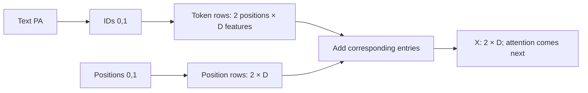
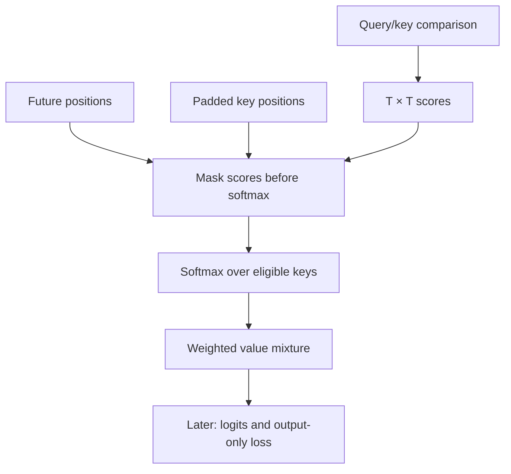

# Tiny Mitra — prerequisite refresher

**Guided restart:** begin with [LEARNING_PATH.md](LEARNING_PATH.md). For the first session, read only Sections 1–2 below. We will trace the small character-token learning pilot before examining the final comparison or its results. The pilot uses 32 features per token and an FFN of 32 → 96 → 32; examples below using 64 features describe the larger final model. The same operations apply with different dimensions. Your own separate training run comes after the walkthrough, with guidance.

Read in small sessions, in this order. This is a study guide, not evidence that you have mastered the material. The accompanying project is at `projects/Week 6/tiny-mitra`; its notebook imports the actual implementation. We will discuss questions and check understanding one concept at a time.

The October 18 instruction authorizes building the engineering work while you are away. Learning milestones remain open until you explain and apply the concepts. Examples below with invented numbers are labeled **teaching examples**, not measured learned behavior.

## 1. Start with the problem

Source: `PATIENT John Lee TREATMENT DrugA`.

Expected target: `PATIENT [NAME] TREATMENT DrugA`.

We must replace the name while preserving which treatment was stated. Always distinguish source, expected answer and actual generated answer. The expected answer is a training/evaluation label, not something the inference function can read.

Our assignment studies a small GPT. A token classifier followed by replacement could also redact text; GPT is our chosen learning exercise, not a requirement for every de-identification system. Our task uses synthetic examples, not real patient records. Later scaffolding/fine-tuning exercises are separate.

The connection to Week 1: we still predict a next token from learned parameters. Here, attention allows predictions to depend on earlier context, and repeated prediction produces an entire transformed note.

## 2. Tokens, vocabulary and encoding

A computer needs an explicit representation of text. A **token** is one unit under a chosen splitting rule. It might be a whole word, a piece of a word, a character, or a protocol marker.

A **vocabulary** maps tokens to integer IDs. A **tokenizer** implements splitting, conversion to IDs (encoding), and reconstruction (decoding). Your earlier description of a word's index was correct for a word-level vocabulary, but tokenization need not use whole words.

Teaching example: vocabulary `PATIENT:0`, `John:1`, `[NAME]:2`, `<UNK>:3`. Encoding `PATIENT John` produces `[0,1]`. The IDs are addresses, like shelf numbers in our Week 3 library analogy. Address 1 is not a meaning vector, and ID 2 is not twice as meaningful as ID 1.

If `Olivia` is absent, a word tokenizer might encode it as `<UNK>`. `Olivia` and `Zoya` then become the same ID. Their spelling is lost. Adding position cannot reconstruct it. This matters because a model unable to emit unseen names can appear to have low leakage for the wrong reason.

The teaching pilot uses characters plus atomic markers: `John` becomes `J,o,h,n`, and `[NAME]` is one token. The final comparison also gives declared task pieces such as `PATIENT`, `DrugA` and `Chemotherapy` their own IDs. Other spelling falls back to characters. This shortens common task sequences while retaining unseen supported spelling. It is a small fixed-piece tokenizer we wrote, not a pretrained tokenizer or a learned BPE vocabulary. Longest-piece matching can also occur inside a word: `Maya` can contain the declared `May` piece plus `a`.

The alphabet is fixed ASCII letters, digits, punctuation, space, newline and tab. Unsupported characters raise an error rather than silently losing information. The vocabulary is not fitted on final-test text. Token offsets record the original character interval represented by each token, making attention inspection interpretable.

Code: `tokenizer.py` and `task_tokenizer.py`. Check: `decode(encode(text)) == text` for supported text, including an unseen name. Representation alone does not establish good behavior: training must expose useful variation, and generated outputs must still be measured.

## 3. Scalars, vectors, matrices and shapes

A scalar is one number, such as a learning rate of 0.001. A vector is an ordered list, such as `[1,2]`. A matrix is a table of numbers. A tensor generalizes these arrays to more axes.

We use B for batch size, T for number of positions, D for feature width, V for vocabulary size and H for attention heads. These letters denote counts, not learned weights. With B=2, T=10 and D=64, the representations have shape `(2,10,64)`: two examples, ten positions per example, 64 numbers per position.

For a row vector `[1,2]` multiplied by a column `[2,1]`, multiply matching entries and add: `1*2 + 2*1 = 4`. In matrix multiplication, the inner sizes must match: `(T,D) @ (D,F)` gives `(T,F)`. The `@` means matrix multiplication. A transpose swaps specified axes; it is not the same operation as splitting one axis with a reshape.

Code: `model.py`, especially attention's reshape and transpose comments. Common mistake: checking that the total element count matches while accidentally mixing token and head axes.

## 4. Embeddings: turn an address into trainable features

An ID alone does not provide useful numerical features. An **embedding table** stores a learned vector for every token. Lookup selects the vector at the token's ID. It does not search the text or calculate attention.

Teaching example, deliberately tiny:

| Token | ID | Embedding row |
| --- | ---: | --- |
| P | 0 | [0.2, -0.1] |
| A | 1 | [0.5, 0.3] |
| space | 2 | [-0.2, 0.4] |

Encoding `PA` as `[0,1]` selects rows `[[0.2,-0.1],[0.5,0.3]]`. The table shape is `(V,D)`; one batch of lookups is `(B,T,D)`. The vectors begin from initialization and change through gradients. We cannot label one coordinate 'patient identity' or 'disease' merely by inspecting it.

A repeated token initially selects the same token row. After position and contextual processing, its representation can differ between occurrences. Embedding parameters are learned; attention weights are instead computed from the current input and learned projection parameters.

An ID can exist even when its input embedding has received no useful data-specific training. The final synthetic-data checks therefore include all52letter IDs in training names, along with different name lengths and numerical values. Exposure permits learning; it does not prove that a particular row or model has learned the intended behavior.

Code: `token_embedding` in `model.py`; the learning notebook shows the actual initialized rows and their shapes.

## 5. Position: distinguish where a token occurs

Token identity alone leaves order information incomplete. Recall Week 4's event-order examples: changing the order can change the meaning even when the words are the same.

We learn a separate position table. At index t, add token vector E[id_t] and position vector P[t]: `X_t = E[id_t] + P[t]`.

Here t is the position index, id_t is its token ID, E and P are the two learned tables, brackets select a row, X_t is the resulting vector and `+` adds corresponding features. Both rows have D entries. Addition keeps D features; concatenation would produce 2D and is a different design.

Teaching example: token row `[0.2,-0.1]`, position row `[0.01,0.04]`, sum `[0.21,-0.06]`. The same token at another position can get `[0.2,-0.1]+[0.03,-0.02]=[0.23,-0.12]`. Position distinguishes the occurrences; it does not recover unknown spelling or incorporate the complete note's context by itself.

Code: the first operations in `TinyGPT.forward`. Context length bounds the available position table. We reject overflow; we do not silently discard the beginning of the source.

The final model allows256positions, while its training examples use fewer. Accepting an input within that bound does not establish reliable behavior at every length. Positions not exposed in training receive no data-specific position updates, although regularization such as weight decay can still change their numbers.

## 6. Linear projections and raw prediction scores

A linear layer transforms features using learned weights and bias. For a row x, `y = xW + b`: W is a weight matrix, b an offset vector, xW matrix multiplication and y the output. Shapes `(T,D) @ (D,F) + (F)` produce `(T,F)` by adding b to every row. PyTorch stores Linear's weight in transposed layout internally; the mathematical relationship is the same.

Attention uses different projections to form Q, K and V. At the end of the model, the vocabulary projection turns D features into V **logits**, one raw score per possible next token. Logits are not probabilities and can be negative.

## 7. Attention: mix earlier context according to the current query

When predicting the treatment letter, the model needs access to what the source said. Treating every earlier token equally would discard useful distinctions. Attention computes a context mixture separately for each current position.

Each token's representation is projected into:

- Q, a query: features used to ask which earlier positions to consult.
- K, a key: features against which queries are compared.
- V, a value: features contributed when that position receives weight.

These are useful analogies, not literal human questions or guaranteed semantic roles. W_Q, W_K and W_V are learned matrices shared across positions. Q, K and V depend on this input.

For a head: `scores = Q @ K_transposed / sqrt(Dh)`.

Q has one query row per position; K_transposed swaps K's position and feature axes; `@` compares each query with each key; Dh is features per head; sqrt is square root; division controls score scale. The result has one row per query and one column per key.

Apply the causal/key-padding masks before softmax. Softmax converts one eligible score row into nonnegative weights summing to one: `weight_j = exp(score_j) / sum_k exp(score_k)`. exp raises the number e to that score, sum adds over eligible key positions, j identifies the current key and k runs over all eligible keys. Subtracting the row maximum first gives the same probabilities with safer numerical scale.

Then `context = weights @ V`: multiply each value vector by its weight and add. Attention mixes value features, not token IDs.

### Complete attention calculation — teaching numbers

Consider the final query in a two-position head with Dh=2. Choose query `[sqrt(2),0]`, keys `[0,1]` and `[ln(3),0]`, values `[2,0]` and `[0,4]`. ln is natural logarithm, so exp(ln(3))=3.

Dot products are 0 and `sqrt(2)*ln(3)`. Divide by sqrt(2): scores `[0,ln(3)]`. Exponentiate: `[1,3]`. Their sum is 4, so weights are `[1/4,3/4]` or `[0.25,0.75]`. The context is `0.25*[2,0] + 0.75*[0,4] = [0.5,3]`.

A future third key must be masked even if its unmasked score is very large. Setting its score to negative infinity gives exp(-infinity)=0. It contributes nothing. These invented weights demonstrate arithmetic; they are not a finding about a trained Mitra head.

Code: `CausalAttention.forward`, in this exact operation order.

## 8. Three masks with different jobs

| Mask | Applied to | Purpose |
| --- | --- | --- |
| Causal | Attention scores | A position cannot consult future positions |
| Key padding | Attention scores | Padding tokens cannot supply context |
| Loss | Training targets | Ignore source-prediction and padding targets when scoring errors |

An ignored source loss does not prevent gradients reaching source embeddings through their contribution to output attention. A key-padding mask and a loss mask are not interchangeable.

Without a causal mask, training can exploit expected future answer tokens that are absent during generation. The causality test changes later IDs and verifies that earlier logits do not change.

## 9. Multiple heads

One learned mixture may be insufficient to represent different relationships. Multiple heads create different projected feature views, each with its own attention mixture. Every head can attend to the eligible earlier sequence; head 1 does not receive only the first quarter of the words.

With D=64 and H=4, each head has Dh=16 features. Q reshapes from `(B,T,64)` to `(B,T,4,16)`, then transposes to `(B,4,T,16)`. Scores become `(B,4,T,T)`. Mixed values are `(B,4,T,16)`. Transpose and merge the head features back into `(B,T,64)`, then apply the learned output projection.

We keep width fixed. Adding heads does not multiply the model width by four. Whether it helps this task is an experiment, not an assumption.

## 10. Residuals, LayerNorm and the FFN

After attention, we need to preserve useful existing features, control feature scale and transform features nonlinearly.

**Residual connection:** add an update to an existing representation. Teaching example: `[1,2] + [0.2,-0.1] = [1.2,1.9]`. This provides a direct path through the block and a corresponding gradient path. It does not guarantee that every trained configuration improves.

**LayerNorm:** normalize each token's feature vector independently. For features x_i, compute mean mu by adding all D features and dividing by D. Variance v is the average squared distance `(x_i-mu)^2`. Output feature i is `gamma_i * (x_i-mu)/sqrt(v+epsilon) + beta_i`. gamma is learned scale; beta learned offset; epsilon a small positive constant preventing division by zero. i selects a feature. Batch and time are not averaged together.

Teaching example: `[1,3]` has mean 2; squared deviations `[1,1]`; variance 1. With gamma=1, beta=0 and epsilon=0.00001, the outputs are approximately `[-0.999995,0.999995]`. Constant features remain finite because epsilon is present. Our custom implementation is checked against PyTorch LayerNorm for values and gradients; the ready-made LayerNorm is only the test reference.

**FFN:** a linear expansion, nonlinear activation and linear contraction, applied independently at each position. Shapes are `D → Dff → D`; here 64→192→64. Our activation is GELU: it smoothly gates values; for example GELU(-1) is approximately -0.1587 and GELU(2) approximately 1.9545. Our earlier NumPy work used ReLU, which would instead produce 0 and 2. Two linear layers without a nonlinearity would collapse into one affine transformation. Attention mixes information between positions; the FFN transforms the features within each position.

Code: `LayerNorm`, `DecoderBlock` and the FFN in `model.py`.

## 11. Assemble the complete decoder

Our full block uses pre-normalization:

`U = X + Attention(LayerNorm_1(X))`

`Y = U + FFN(LayerNorm_2(U))`

X is the input representation, U the representation after attention/residual, Y after FFN/residual, and subscripts 1 and 2 distinguish separately learned normalization layers. Every intermediate has `(B,T,D)` shape. LayerNorm comes before each branch, unlike post-LN ordering in some older prose.

Two blocks repeat this processing. Final normalization and vocabulary projection give `(B,T,V)` logits. Stacking increases depth and parameter count; any measured benefit must be evaluated with that capacity difference disclosed.

Our variants: embedding-only; bare single attention; bare multi-head attention; one full block; two full blocks; two blocks without FFN; without any LayerNorm; without residual additions. The bare attention variants share the same residual/norm policy. Removing FFN also makes its associated pre-normalization branch unused, which must be disclosed.

## 12. From logits to learning

If two logits are `[ln(3),0]`, softmax gives `[0.75,0.25]`. For the correct first token, cross-entropy is `-ln(0.75)`, approximately 0.2877. If the second token is correct, loss is `-ln(0.25)`, approximately 1.3863. A lower probability for the correct answer produces a larger penalty.

Here the minus sign makes negative log-probability a nonnegative penalty. Training averages this penalty over scored tokens, not over every position indiscriminately. Validation sums token losses and divides by the total scored-token count; averaging unequal batch means can produce a different answer.

**Backpropagation** uses the chain rule to calculate each parameter's effect on the loss. **Autograd** performs that derivative bookkeeping through our operations. The **optimizer** updates parameters using those gradients. We still choose the architecture, target mask, objective and training loop.

For simple gradient descent, `new_weight = old_weight - learning_rate * gradient`. Teaching example: weight 2, gradient 8, learning rate 0.01 gives `2-0.08=1.92`. AdamW, used in our project, additionally maintains running gradient statistics and applies weight decay. Its state is therefore needed to resume the same training process.

Each update: forward, compute loss, clear previous gradients, backward, inspect/clip gradients, optimizer step. Gradient clipping limits update-driving gradient magnitude; it does not repair a wrongly defined target or mask.

## 13. Teacher forcing, target shift and output-only loss

We concatenate protocol markers, source and expected output:

`<BOS><INPUT>PATIENT John<OUTPUT>PATIENT [NAME]<EOS>`

A **word-level teaching table** makes alignment readable by grouping words and omitting whitespace positions. Actual tokens depend on the selected representation: the final tokenizer keeps `PATIENT` whole, spells an ordinary new name with pieces/characters and retains whitespace. Run the notebook for the actual positions and masks.

| Input position | Input token | Target to predict | Score loss? |
| ---: | --- | --- | --- |
| 0 | BOS | INPUT | No |
| 1 | INPUT | PATIENT | No |
| 2 | PATIENT | John | No |
| 3 | John | OUTPUT | No |
| 4 | OUTPUT | PATIENT | Yes |
| 5 | PATIENT | [NAME] | Yes |
| 6 | [NAME] | EOS | Yes |

Inputs omit the final token; targets omit the first token. At OUTPUT, predict the first output token: `P` for the character pilot, `PATIENT` for the final fixed-piece model. The EOS prediction is trained. Right padding fills a batch to equal lengths but is ignored as a loss target and as an attention key.

During training, expected earlier output tokens are supplied: **teacher forcing**. During free generation, earlier outputs come from the model itself. Errors can therefore compound during generation even when teacher-forced token accuracy is high.

Code: `training_item` and `batch_items` in `data.py`; the final loss/update loop is `train_task` in `task_runtime.py`. `train.py` preserves the earlier character experiment.

## 14. Checkpoints and generation

A checkpoint contains learned numbers plus enough information to reconstruct their meaning: architecture, tokenizer, source/data hashes, configuration, seeds, selection rule and versions. Our best/latest files both preserve optimizer, step, sample order, RNG state and history. Latest allows recovery of the most saved progress. The inference choice follows the declared experiment rule: the final comparison uses the fixed4,000-update latest checkpoint; its minimum-validation-loss best checkpoint remains a separate diagnostic. Lower teacher-forced loss does not automatically mean better generated notes.

Training one architecture creates its own learned parameters. Switching a Gradio dropdown loads its matching checkpoint; it does not convert one network's weights into another architecture or start training again.

Generation begins with source through OUTPUT. Take the last position's logits, choose one token, append it and run the extended prefix again. Stop at EOS, a declared output limit or a declared context limit. Return the termination reason, not just a string. No silent sliding window should remove the original source.

**Greedy** means choose the highest logit. **Sampling** uses probabilities after dividing logits by positive temperature. Low positive temperature concentrates probability but remains random; higher temperature spreads it. For logits `[2,1]`, dividing by T=0.5 gives `[4,2]` and probabilities about `[0.881,0.119]`. At T=1, probabilities are about `[0.731,0.269]`. Greedy chooses the first in both cases. Temperature and decoding method are separate controls.

In Colab, calculations happen remotely; our Python architecture stays the same. Save durable copies because runtime disk can disappear. Download weights/tokenizer/configuration and test CPU loading before the demo. Actual cloud execution remains a separate gate.

## 15. Evaluation and hypotheses

A model can predict common letters correctly and still leak an identifier or change a clinical field. Report teacher-forced loss/accuracy separately from generated-note metrics.

For redaction, TP counts correctly located and typed replacements, FP incorrect or unnecessary replacements, and FN missed required replacements. Precision is `TP/(TP+FP)`; recall is `TP/(TP+FN)`; F1 is `2TP/(2TP+FP+FN)`. With TP=8, FP=2, FN=1: precision=0.8, recall≈0.889 and F1≈0.842. A zero denominator is reported as unavailable, not invented perfection.

Also inspect exact matches, original identifier surfaces remaining in output, correct clinical field/value associations, no-identifier controls, termination, parameter count and latency. Our exact-surface leakage scan can miss reformatted or partial identifiers; it is a bounded synthetic diagnostic. Placeholder totals alone do not locate correct replacements. Clinical keyword presence alone does not preserve their associations.

Use separate known/unseen entity and template conditions. Validation chooses checkpoints/settings; final-test examples must not guide tuning. Repeated seeds show sensitivity to initialization. Small samples and one seed leave substantial uncertainty.

A hypothesis is a question with an expected direction recorded before results. Example: does a second block improve held-out quality under our fixed budget? Record the change, metrics/support counts, actual outputs, interpretation and limitation. Use supported, contradicted, mixed or inconclusive; an experiment does not universally prove an architecture superior. Formal significance tests are not mandatory for this small assignment; any later test must respect paired examples and seed structure.

## 16. Heads and components: what the evidence means

A heatmap shows where attention goes for a selected query in a selected example. It does not by itself establish why a decision happened or name a head's permanent purpose.

Zeroing one head's context before output projection measures dependence on that trained head under the intervention. If recall drops on enough labeled MRN examples, that supports a contribution on those tests; counterfactual source edits and other examples help assess the interpretation. If disabling a head improves results, its contribution was undesirable on those examples. Little effect can reflect compensation, the tested sample or another cause, not universal uselessness.

Single-head and paired-head interventions do not retrain weights. Component comparisons use separately trained architectures. Removing LayerNorm from an already-trained network asks a different question from training a network without LayerNorm.

Use the same speaking pattern for every finding: question → change → observation → interpretation → limit. Inspect unexpected results rather than rewriting the conclusion to match theory.

## Where this appears in AI and in our project

The ID lookup and position example are the first lines of a Transformer forward pass. The `[0.25,0.75]` calculation is one attention row. The 0.2877 loss example is one scored next-token decision. Backpropagation connects that penalty to projection and embedding parameters. Gradio presents the continuation produced by repeatedly applying this path; saved reports explain the measured comparisons.

PyTorch handles tensors, basic modules, autograd and optimizers. We assemble attention, normalization, blocks and generation ourselves. No nn.Transformer, nn.MultiheadAttention, fused attention operation, pretrained model or external language-model API implements our model.

## Reading order and our earlier work

1. Sections 1–5: connect Weeks 1–2 encoding and Week 3's library/books analogy to actual embedding lookup.
2. Sections 6–9: revisit our Week 3 attention calculation and Week 4 event-order example.
3. Sections 10–13: connect Week 5 components to the full forward/loss/update path.
4. Sections 14–16: learn checkpoint workflow, inspect real outputs and revisit Week 5's experiments with the new metrics.
5. Run `learning_walkthrough.ipynb`, importing the shared Python modules. We will pause for questions before each learning check.

## My understanding

Reserved for Nagar and the team. Write explanations in your own words after reading and discussion. No explanation has been filled in on your behalf and no learning milestone is automatically complete.

## Quick revision prompts

We will take these one at a time: What does an ID select? What spelling can UNK lose? What does position add? Which earlier positions can one query consult? What changes between heads? Which targets contribute loss? How does free generation differ? What exactly does a head intervention establish?

## Sources

Synthesized in original language from our reference map: Alammar and Grootendorst, *Hands-On Large Language Models*, Chapter 2, tokenization/embeddings, and Chapter 3, inside the Transformer block; Goodfellow, Bengio and Courville, *Deep Learning*, §4.3 gradient-based optimization and the feedforward/optimization chapters. The local Raschka-labeled LLM file contains different book material and was not used as an architecture source. Implementation-specific choices follow the instructor assignment and IMPLEMENTATION_PLAN.md.
