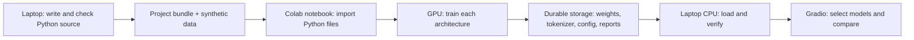

# Where Tiny Mitra will train

Recommendation, October 18, 2026: start with **Google Colab Free**, measure one small run, then decide whether more compute is needed. We have not connected to or trained on a cloud GPU yet.

## The choices

| Option | What it gives us | Decision for this project |
| --- | --- | --- |
| Colab Free | Hosted Jupyter notebooks, with GPU access subject to availability and changing usage limits | First candidate; beginner walkthrough needed |
| Kaggle Notebooks | Hosted notebooks with GPU acceleration and an account GPU quota | Backup if Colab access is insufficient; check the quota shown in the account |
| Paid Colab | More compute access depending on plan, compute balance and availability; ordinary paid plans still have limits | Consider only after timing the pilot and identifying a specific shortfall |
| Local CPU | Available without a cloud session; speed depends on our workload | Correctness checks, small learning examples and the intended Gradio demo |

The choice of Colab is our judgment about simplicity for this assignment, not a measured speed comparison between providers. We do not yet know whether all eight runs will fit the free allocation. Avoid quoting a fixed free GPU type, hour allowance or promised completion time.

Provider facts: [Colab FAQ](https://research.google.com/colaboratory/faq.html), [Kaggle notebooks](https://www.kaggle.com/docs/notebooks), [Kaggle GPU usage](https://www.kaggle.com/docs/efficient-gpu-usage). Check the account's actual offering when starting a session. Checked October 18, 2026.

## What Colab means

Colab is a notebook in the browser. Each cell contains either explanation or code. Pressing its run button executes that cell on a remote machine. A **GPU** is a processor that can accelerate the large batches of matrix calculations used in training. Allocating a GPU does not automatically move our model onto it: our code must put the model and its input tensors on the selected device.

Our `.py` files remain the source of the model. The training notebook is a short control panel that imports and runs those files. Gradio imports the same implementation on the laptop.

This changes where calculations happen; it does not change our PyTorch boundary. Q/K/V, masks, multi-head attention, FFN, residuals, custom LayerNorm, blocks and generation are still our implementation. No pretrained model or ready-made Transformer is introduced by using a cloud GPU.

## What we will run, in order

These are acceptance requirements for the forthcoming notebook, **not commands already tested in Colab**.

1. Open the supplied notebook in the user's Google account. Choose an available GPU runtime and show how to connect. No purchase is required for the initial attempt.
2. Load a small project bundle containing our Python files and synthetic examples. Do not upload the entire learning repository or its reference library. Verify a source/data manifest before running.
3. Check Python/PyTorch versions, GPU availability and device name. Explain the output. If no GPU is allocated, stop the batch-training path clearly rather than silently claiming GPU execution.
4. Run the same correctness checks used locally, then one tiny-batch learning check. A working GPU import alone does not demonstrate a correct model.
5. Time a short pilot with the proposed model and real token lengths. Report steps/second, total scored tokens, memory use and validation behavior. Synchronize GPU timing. Estimate eight runs using the actual update budget plus evaluation overhead, with uncertainty.
6. Train one model first. Save its latest resumable state and its best validation checkpoint. Reload and evaluate before dispatching the remaining architectures.
7. Run the registered comparison schedule using the shared experiment runner. Resume completed runs by matching source/data/configuration identities, not just filenames.
8. Save versioned checkpoints, metadata, histories and reports to durable storage regularly. Train from runtime-local files to avoid many small Drive reads. Verify completed copies before treating them as recoverable backups.
9. Deliberately interrupt a short run and resume it. Show that completed steps, optimizer state, data order and random state are restored. A resumed run on another device need not be bitwise identical; disclose the device change.
10. Download one complete model bundle. Load its state on a fresh local CPU model, verify compatible tokenizer/configuration, compare logits within a stated tolerance and check a recorded greedy continuation. Resolve any changed token decisions before claiming portability.

## What must be saved

| Artifact | Why we need it |
| --- | --- |
| Learned parameter dictionary | The trained numbers |
| Architecture/configuration | Reconstruct the matching network |
| Tokenizer/alphabet/control-token metadata | Preserve the meaning of every ID |
| Dataset and source fingerprints | Know which code and examples produced the model |
| Run manifest and versions | Explain seeds, budget, device and environment |
| Best validation checkpoint | Selected model for inference under the declared rule |
| Latest resumable checkpoint | Optimizer, completed progress, sampler/data order and random states |
| Histories, raw outputs and experiment reports | Compare actual runs and explain the findings |

Saving weights alone is insufficient to resume training. A checkpoint for one architecture cannot be loaded as another architecture merely by changing a dropdown label. PyTorch supports explicit CPU loading of saved parameters; our own compatibility and generation checks must still pass. [PyTorch saving/loading guide](https://docs.pytorch.org/tutorials/beginner/saving_loading_models.html)

## The presentation

Run Gradio locally using already downloaded checkpoints and reports. A dropdown loads the chosen trained architecture. A comparison button runs the same note through selected checkpoints. It does not retrain them. We will measure the actual CPU inference latency before declaring this arrangement ready.

Cloud training will not be marked done until actual GPU execution, interruption/resume and GPU-to-CPU loading are evidenced. Creating this document or a notebook is only preparation. Colab runtime files can disappear on disconnection or session termination, and free-tier use primarily through a separate web UI is restricted; the planned interactive notebook training and local Gradio split fits the intended workflow. [Colab FAQ](https://research.google.com/colaboratory/faq.html)
